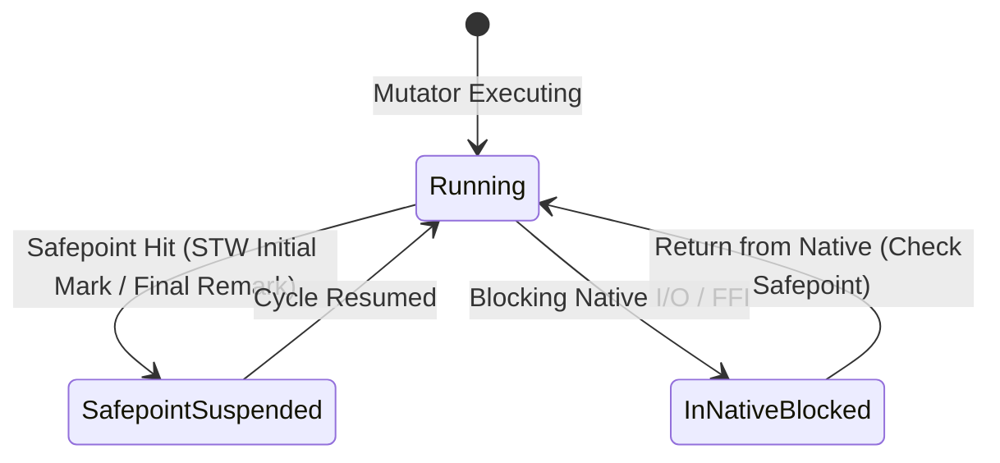

# ADR 0008.2: Resource Leases, Arc/GC Synchronization & Safepoint Lifecycle

- **Status**: ACCEPTED [Binding Implementation Specification]
- **Date**: 2026-11-10
- **Version**: 1.2 (Companion to ADR 0008.1)
- **Scope**: Concurrency Safety, Native Resource Subsystem, Arc Root Registry, GC Safepoint Engine

---

## 1. Specification Scope & Architectural Objective

This specification hardens three critical runtime interfaces that bridge Concurrency, Memory, and Resource Lifecycles:
1. **Resource Operation Leases**: Eliminating race conditions between concurrent I/O (`read`/`write`) and deterministic `close()`.
2. **Arc / GC Root Registry Synchronization**: Guaranteeing thread-safe snapshotting and root write barriers during concurrent GC passes.
3. **Mutator Safepoint Lifecycle**: Defining thread state transitions, native blocking I/O parking, and the 4-phase Major GC lifecycle.
4. **Background Resource Reaper**: Decoupling OS descriptor release from garbage collection worker threads.
5. **Cleanup Transfer & Multi-Failure Chaining**: Defining exact ownership slot transfer on `move` and complete error preservation.

---

## 2. Resource Operation Lease Protocol

### 2.1 Separation of Owner Handle and Control Block
To eliminate state confusion between variable movement and physical resource state:
- **`ResourceOwnerHandle`**: Tracks variable-level ownership. Contains a boolean `moved` flag and points to the control block.
- **`ResourceControlBlock`**: Manages the underlying OS descriptor and operation concurrency.

```cpp
enum class ResourceState : uint8_t {
    Open,
    Closing,
    Closed
};

struct ResourceControlBlock {
    std::atomic<ResourceState> state{ResourceState::Open};
    std::mutex mtx;
    std::condition_variable cv;
    uint32_t active_operations{0};
    int native_fd{-1};
    std::string descriptor_name;
    std::function<void(int)> native_close_fn;
};

struct ResourceOwnerHandle {
    std::shared_ptr<ResourceControlBlock> control;
    bool moved{false};
};
```

### 2.2 Operation Lease Lifecycle (`ResourceLease`)
Any read or write operation on a resource must acquire an ephemeral RAII `ResourceLease`:

```cpp
class ResourceLease {
public:
    explicit ResourceLease(std::shared_ptr<ResourceControlBlock> block)
        : block_(std::move(block)) {
        if (!block_) throw std::runtime_error("Invalid resource handle.");
        std::unique_lock<std::mutex> lock(block_->mtx);
        if (block_->state.load(std::memory_order_relaxed) != ResourceState::Open) {
            throw std::runtime_error("Cannot operate on closed resource '" + block_->descriptor_name + "'.");
        }
        block_->active_operations++;
    }

    ~ResourceLease() {
        if (block_) {
            std::lock_guard<std::mutex> lock(block_->mtx);
            block_->active_operations--;
            if (block_->active_operations == 0 &&
                block_->state.load(std::memory_order_relaxed) == ResourceState::Closing) {
                block_->cv.notify_all();
            }
        }
    }

    int fd() const noexcept { return block_->native_fd; }

private:
    std::shared_ptr<ResourceControlBlock> block_;
};
```

### 2.3 Deterministic `close()` with In-Flight Drain
When `close()` is invoked:
1. Transition state from `Open -> Closing` under lock.
2. If `active_operations > 0`, wait on `cv` until `active_operations == 0`.
3. Invoke `native_close_fn(native_fd)`.
4. Transition state to `Closed`.
5. Release lock and notify all waiting threads.
6. Subsequent calls return `false` as safe atomic no-ops.

---

## 3. Arc / GC Root Registry Synchronization

### 3.1 Registry Architecture
`Arc<GCObject>` acts as an atomic cross-thread root provider. To prevent race conditions during concurrent GC root scanning:

```cpp
class ArcRootRegistry {
public:
    static ArcRootRegistry& instance();

    // Invoked when an Arc is created or its count transitions 0 -> 1
    void register_root(void* gc_ptr);

    // Invoked when Arc strong count drops to 0
    void unregister_root(void* gc_ptr);

    // Invoked by the GC coordinator during STW Initial Mark
    std::vector<void*> snapshot_roots();

    // Root Write Barrier during Incremental Marking
    void write_barrier_root(void* gc_ptr);

private:
    std::shared_mutex registry_mtx_;
    std::unordered_map<void*, size_t> active_roots_;
};
```

### 3.2 Synchronization Invariants
1. **Atomic Snapshot**: During the STW Initial Mark phase, the GC acquires an exclusive lock on `ArcRootRegistry` to capture an exact snapshot vector of all live roots.
2. **Decoupled Reclamation**: Dropping an Arc count to zero removes the entry from `active_roots_`. It **never** frees memory directly. Memory reclamation is performed exclusively by the GC.
3. **Root Write Barrier**: If a mutator registers or transfers an Arc root while `gc_phase == GCPhase::IncrementalMarking`, the target object is shaded Grey via `write_barrier_root()`.

---

## 4. Mutator Safepoint Lifecycle & 4-Phase Major GC



### 4.1 Four-Phase Major GC
1. **Initial Mark (STW)**:
   - Request safepoint. All mutators suspend.
   - Snapshot roots from Interpreter environments, VM call frames, operand stacks, and `ArcRootRegistry`.
   - Resume mutators.
2. **Incremental Marking (Concurrent / Interleaved)**:
   - GC worker threads trace the object graph in slices.
   - Mutators continue executing with active `write_barrier_marking` and `write_barrier_root`.
3. **Final Remark (STW)**:
   - Brief STW pause to flush dirty cards from the Generational Card Table and drain the grey worklist.
4. **Sweep (Concurrent / Lazy)**:
   - Reclaim all unmarked (white) objects.

### 4.2 Expanded Safepoint Locations
Safepoints are checked at:
- Loop back-edges.
- Function call prologues.
- Slow-path memory allocations (`ManagedHeap::allocate_slow()`).
- **Native / Blocking I/O**:
  - Before entering blocking syscalls (`read`, `accept`, `sleep`), the thread calls `ThreadManager::enter_native()`.
  - The GC treats `InNative` threads as parked and considers their roots frozen.
  - Upon return, the thread calls `ThreadManager::exit_native()`. If a GC STW pause is active, the thread suspends before touching the heap.

---

## 5. Background Resource Reaper Queue

To maintain deterministic GC worker pause times and prevent deadlocks with blocking OS calls:
- **GC Workers Never Close Resources Directly**.
- If the GC sweeps a `ResourceControlBlock` whose state is still `Open` (abandoned resource leak):
  1. Emit diagnostic: `[WARN: LEAK] Unclosed resource '...' enqueued to Reaper`.
  2. Push the control block to the thread-safe `ResourceReaperQueue`.
  3. A low-priority background thread drains the queue, acquires operation locks, drains leases, and cleanly releases native descriptors.

---

## 6. Multi-Cleanup Error Chaining & Ownership Move in `using`

### 6.1 Multi-Cleanup Error Policy
When exiting a lexical scope with multiple cleanup handlers:
```
Let H_1, H_2, ..., H_n be the cleanup handlers executed in LIFO order.
Let E_active be the in-flight exception (or null if normal exit).

For each handler H_i:
    Try:
        H_i.close()
    Catch E_clean:
        If E_active is null:
            E_active = E_clean   // First failure becomes Primary Exception
        Else:
            E_active.suppressed.push(E_clean) // Subsequent failures attached as Suppressed

If E_active is not null:
    Throw E_active
```
**Guarantee**: Every cleanup handler executes regardless of errors thrown by preceding handlers. Zero resources are leaked.

### 6.2 Ownership Slot Transfer on `move`
Inside `using res = expr { ... }`:
- The cleanup registration binds to an internal **Resource Slot ID**, not the variable name.
- When `let res2 = move res;` is executed:
  - `res.moved` is set to `true`.
  - `res2` takes ownership of the Resource Slot.
  - The cleanup handler at scope exit closes the resource via `res2`.
- When `return move res;` is executed inside a function:
  - Ownership transfers to the caller's evaluation stack.
  - The local scope's cleanup handler is disarmed (`cleanup_handler.disarm()`).

---

## 7. Verification Standards

| Test Suite | Verifies | Tool |
|:---|:---|:---|
| `resource_lease_drain_test` | `close()` waits for concurrent `read()` lease to complete before closing FD. | TSan |
| `arc_registry_snapshot_test` | Zero race conditions when registering Arc roots during GC Initial Mark. | TSan |
| `native_blocked_safepoint_test` | GC proceeds without blocking when a worker thread is asleep in `sleep()` / blocking socket. | ASan |
| `multi_cleanup_chaining_test` | All 3 failed cleanups captured (1 primary + 2 suppressed). | Unit Test |
| `resource_reaper_drain_test` | Leaked resource closed cleanly by background reaper thread without GC stalls. | Unit Test |
