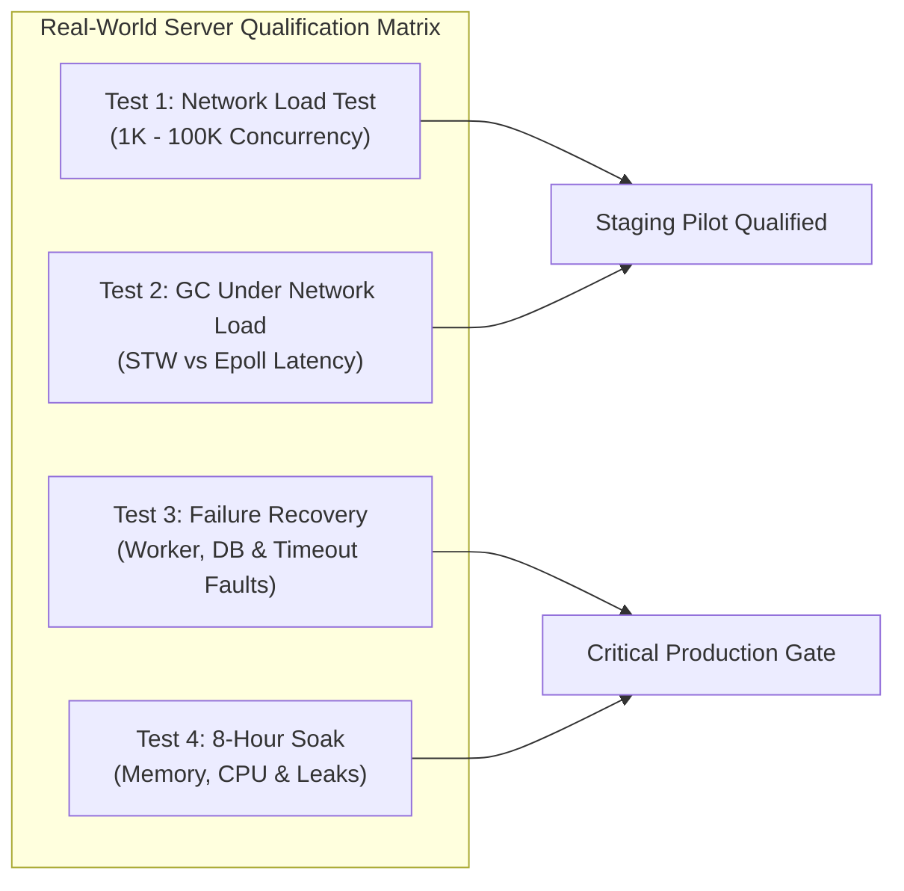

# Raven v1.4.0 — Real-World Server Qualification Plan

**Document Status**: Formal Server Qualification Specification  
**Architecture Freeze Reference**: ADR 0008.1 / ADR 0008.2 (Memory & Concurrency Engine Locked)  
**Target Milestone**: Controlled Staging Pilot $\to$ Critical Production Gate  

---

## 1. Transparency & Baseline Disclosure: What Was Measured in Gate 9

The preliminary Server Integration Benchmark (`tests/benchmark/http_integration_benchmark.cpp`) measured **in-process runtime execution throughput and latency**.

### Scope of Current In-Process Benchmark
- **Payload Execution**: AST execution of simulated request logic (request map decomposition, quadratic calculation, response map synthesis).
- **Execution Layer**: Pure in-memory interpreter loop per worker thread (`raven::Interpreter`).
- **Concurrency**: 4 independent worker threads + 1 GC coordinator thread continuously triggering Stop-The-World (STW) safepoints.
- **Excluded Layers**: Kernel TCP network stack, `epoll`/`io_uring` event loop, HTTP wire-protocol serialization/deserialization, and socket I/O system calls.

> [!NOTE]
> **Engineering Conclusion**: The 1.68M RPS and 7.4µs p99 latency prove that **the Raven execution engine and safepoint barrier add virtually zero overhead (sub-10µs)** to request processing. However, they do not simulate physical TCP socket saturation or kernel networking constraints.

---

## 2. Four Mandatory Real-World Server Qualification Tests

To advance Raven from **Staging Sidecar Pilot** to **Critical Production Component**, the following four end-to-end tests are defined:

---

### Test 1: Real-World HTTP Network Socket Load Test
* **Objective**: Measure real socket handling under client connection pressure.
* **Architecture**: Standalone HTTP server or reverse-proxy fronted sidecar listening on TCP port `8080`.
* **Traffic Generators**: `wrk2` / `k6` executing over loopback and LAN Gigabit interfaces.
* **Connection Concurrency Levels**:
  - **Tier 1**: 1,000 persistent Keep-Alive connections.
  - **Tier 2**: 10,000 concurrent connections.
  - **Tier 3**: 50,000 concurrent connections.
  - **Tier 4**: 100,000 concurrent connections (C100K stress).
* **Payload Profiles**:
  - *Small payload*: 256 bytes JSON (healthcheck/compute).
  - *Medium payload*: 4 KB JSON (user profile & transactional state).
  - *Large payload*: 64 KB JSON (batch aggregation result).
* **Pass Criteria**:
  - Zero dropped connections or socket reset errors (`ECONNRESET`).
  - p99 end-to-end network latency $\le 25 \text{ ms}$ under Tier 2 (10,000 connections).

---

### Test 2: Stop-The-World GC Pauses Under Network Saturation
* **Objective**: Validate that GC pauses do not cause TCP socket back-pressure or epoll worker starvation.
* **Conditions**: Continuous generation of short-lived heap allocations (100 MB/sec allocation rate) during peak network saturation.
* **Telemetry**:
  - Live socket buffer queue length (`ss -nt`).
  - GC pause duration distribution (p50, p95, p99, max pause).
  - Request timeouts at the client tier.
* **Pass Criteria**:
  - Max STW pause $\le 5.0 \text{ ms}$ at 50,000 tracked heap roots.
  - Zero client-side request timeouts (500ms client timeout threshold).

---

### Test 3: Chaos Engineering & Fault Recovery
* **Objective**: Guarantee that abnormal worker states, network disconnections, and cascading timeouts never bring down the primary host service.
* **Fault Injection Scenarios**:
  1. **Worker Thread Crash**: Worker abruptly aborts during active request processing. Supervisor must spawn a healthy worker in $< 50 \text{ ms}$ without dropping adjacent requests.
  2. **Upstream Database/Redis Drop**: Upstream network connection severed mid-request. Worker leases must cleanly drain, close file descriptors, and release locks via RAII `using` without leaking socket handles.
  3. **Slow Client / Request Timeout**: Client hangs mid-transmission. Worker timeout must interrupt execution, unwind the call stack, and recycle the worker environment.
* **Pass Criteria**:
  - 100% of leaked resources reclaimed by `ResourceReaperQueue`.
  - Zero zombie threads or orphaned socket descriptors (`lsof` audit).

---

### Test 4: Extended 8-to-12 Hour Production Soak Test
* **Objective**: Long-duration endurance verification under oscillating diurnal traffic patterns.
* **Duration**: 8 to 12 hours continuous execution.
* **Monitoring Matrix**:
  - **RSS Memory Profile**: Sampled every 60 seconds; must achieve a stable plateau after initial warmup ($\Delta \text{RSS} \le 5\%$ over the final 4 hours).
  - **Heap Object Count**: Verified against live reference tracker.
  - **CPU Utilization**: Zero runaway spinning or livelock contention across the 32 `ArcRootRegistry` stripes.
* **Pass Criteria**:
  - Clean exit after 8 hours with zero crashes, invariant violations, or monotonic memory growth.

---

## 3. Production Deployment Recommendation

| Deployment Phase | Responsibility Scope | Permitted Systems | Verification Requisite |
|:---|:---|:---|:---|
| **Phase 1: Staging Pilot (Current)** | Non-critical asynchronous background processing, report generation, cache warming | Staging / Pre-prod environment | Gates 1–9 Complete (Current Status) |
| **Phase 2: Sidecar Microservice** | Parallel data transformation, event filtering behind Circuit Breaker | Production (Read-only / replayable) | Tests 1 & 2 Complete |
| **Phase 3: Core Service Integration** | Synchronous API endpoints, state mutation pipelines | Core Production Stack | Tests 3 & 4 Complete + Formal Sign-Off |
